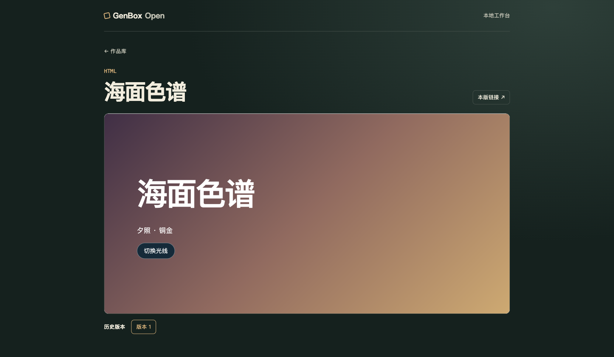

# GenBox Open

把一份 HTML、Markdown 或 SVG 放进本机作品库。你可以把阅读链接交给同一台机器上的浏览器或 Agent，继续修改文件，也可以把某一版固定下来，留给下一次复查。

[打开中文交互展示](docs/index.html) · [查看 Agent Skill](skill/genbox-open/SKILL.md) · [浏览器实拍](docs/evals/artifacts/local-preview.png)

## 从第一条链接开始

需要 Python 3.9 或更高版本，以及 Python 随附的 SQLite。下载仓库后进入项目目录，在终端运行以下命令。整个本地流程可离线完成。

```bash
python3 genbox.py publish examples/field-notes.md --title "海岸线观测手记"
python3 genbox.py serve
```

第一条命令返回 JSON。打开其中的 `url` 阅读当前版本，保存 `revision_url` 可以在日后重新打开这一版。第二条命令在当前终端持续提供预览。也可以直接访问作品库首页，查看已发布的文件。[本机作品库](http://127.0.0.1:4310/)



## 给同一条链接追加版本

在另一个终端进入项目目录，把下面的 `SLUG` 换成首次发布得到的 `slug`。

```bash
python3 genbox.py publish examples/tide.html --replace SLUG --title "海面色谱"
python3 genbox.py history SLUG
python3 genbox.py restore SLUG 1
python3 genbox.py list
```

现在打开原来的阅读链接，会重新看到最早那篇手记。版本记录中仍能找到中间的交互网页。恢复操作把选中的内容和标题写成一个新版本，适合审阅设计稿、保存 Agent 生成结果和并排复查两次输出。

| 打开 | 看到的内容 |
| --- | --- |
| `/s/SLUG` | 当前版本，刷新后跟随更新 |
| `/s/SLUG?v=2` | 固定版本，可在页尾切换历史记录 |

## 本地存储与渲染

作品保存在 `~/.genbox-open/library.sqlite3`，包括标题、源文档、版本号和恢复来源。每次更新在同一 SQLite 事务里读取最新版本并追加一条记录。当前实现保留所有版本。单文件上限为 1 MiB，须为 UTF-8。

- `127.0.0.1:4310` 展示作品库和版本选择器。它把内容放在独立来源的 `iframe sandbox="allow-scripts"` 中。
- `127.0.0.1:4311` 负责正文。响应同时带有 CSP `sandbox allow-scripts` 和指向作品库来源的 `frame-ancestors`。单文件内联脚本、样式和 data 图片可用。外部字体、CDN 脚本及网络请求受策略限制。
- Markdown 支持标题、段落、无序列表和围栏代码块。HTML 标签作为文本显示。HTML 和 SVG 可直接预览。
- 本地写入由当前操作系统用户通过 CLI 完成。HTTP 服务仅接受读取请求，两个端口都绑定回环地址。访问范围是本机，短链地址随本机预览服务的生命周期生效。

在同一组命令中设置 `GENBOX_DATA_DIR` 即可切换作品库，也可使用全局参数 `--data-dir`。如果端口已被占用，请在发布时传入相应的作品库端口。

```bash
python3 genbox.py --data-dir ./workshop publish examples/tide.html --port 8410
python3 genbox.py --data-dir ./workshop serve --port 8410 --content-port 8411
```

## 给 Agent 装上本地 Skill

在仓库目录运行以下命令。它把仓内技能链接到 `~/.agents/skills/genbox-open`，适用于支持该技能目录的 Agent。保留本地仓库即可随代码更新。对其他技能目录可使用 `install-skill --dir PATH`。

```bash
python3 genbox.py install-skill
```

然后可以告诉 Agent「把海岸手记放进本地 GenBox，给我阅读链接和固定版链接」。技能随附的脚本从任意工作目录都可调用。[技能说明](skill/genbox-open/SKILL.md)

## 可选的托管上传

需要跨设备阅读时，可向自己选定的 GenBox 兼容服务上传。先在运行进程的环境中设置该服务签发的 `GENBOX_TOKEN`。以下示例里的 `$GENBOX_ORIGIN` 代表你确认过的服务地址。

```bash
python3 genbox.py send examples/field-notes.md --base-url "$GENBOX_ORIGIN"
```

客户端调用公开的 `POST /api/v1/contents?format=md&visibility=private` 契约，并从回复提取 `slug`、`url` 及可选的 `expires_at`。默认可见性为 private，显式传入 `--visibility public` 可请求公开发布。远端要求 HTTPS，回环地址支持 HTTP。该命令会向指定的服务发送文件。账户、设备凭据签发、管理、审核及计费由托管服务自行提供。

## 验证

```bash
python3 -m unittest discover -s tests -v
```

测试使用临时目录和随机回环端口，覆盖更新与恢复后重新打开数据库、并发追加、失败回滚、双端口路由、渲染响应头、SVG、技能安装及托管文本上传的本机契约夹具。托管上传测试在本机执行，线上联调未纳入这次验收。[原始测试输出](docs/evals/artifacts/open-unittest.txt)

## 授权

源代码、随附示例与说明文档采用 MIT 许可。宣传片、视频声轨和声线素材的权利由其权利人保留，代码许可不授予复制声线或再分发媒体的权利。[MIT 许可证](LICENSE)
