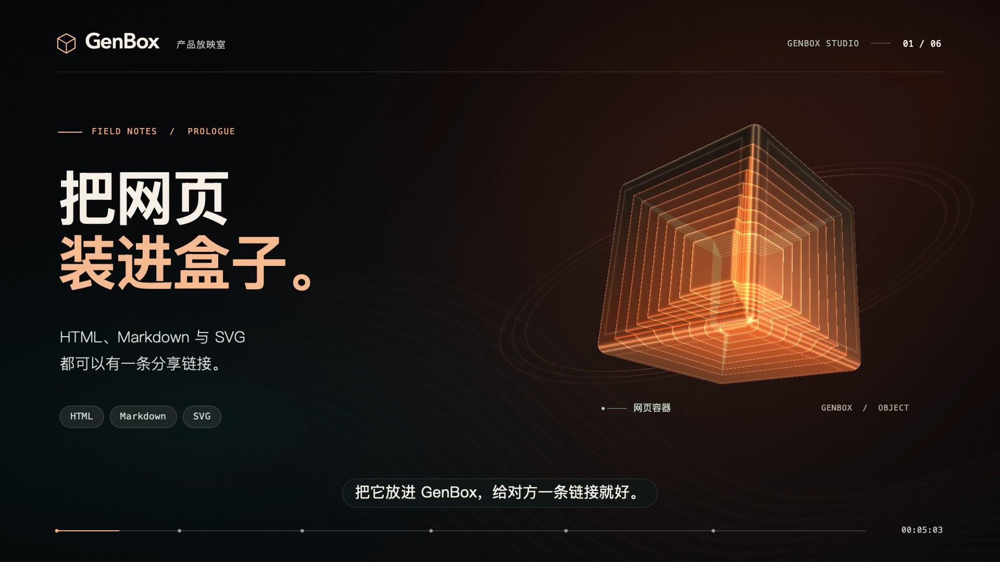
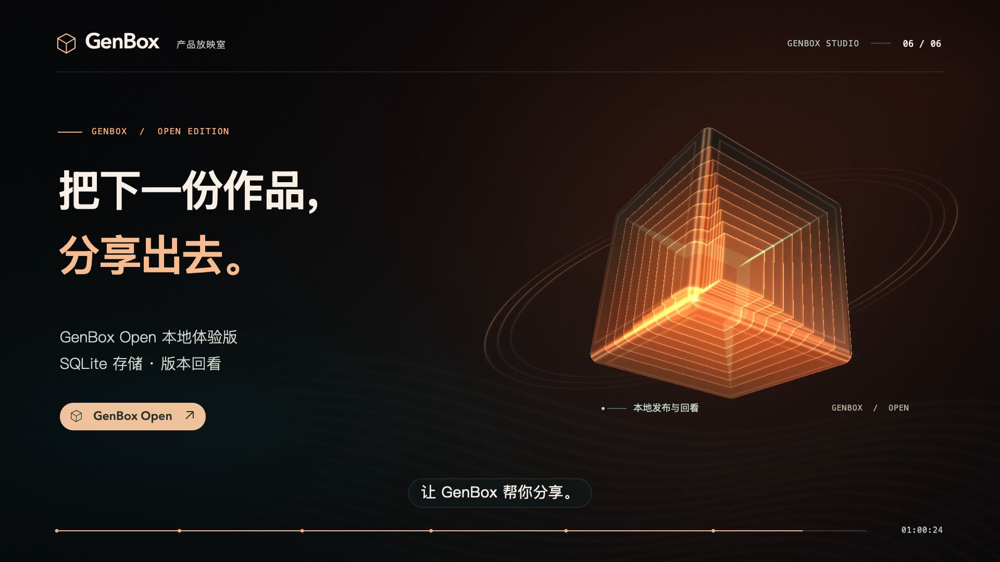
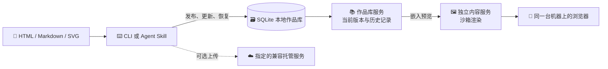

<div align="center">

# 📦 GenBox Open

**把作品装进盒子，让一条链接带它抵达读者。**

写好的网页、讲义或插画，怎么让人打开就能看见？

[](https://www.python.org/)
[](https://www.sqlite.org/)
[](LICENSE)
[](https://raymortwinkle.github.io/GenBox-Open/)
[](https://raymortwinkle.github.io/GenBox-Open/media/promo.mp4)
[](https://github.com/RayMorTwinkle/GenBox-Open)

[✨ 在线交互体验站](https://raymortwinkle.github.io/GenBox-Open/) · [🎬 观看中文宣传片](https://raymortwinkle.github.io/GenBox-Open/media/promo.mp4) · [🚀 3 分钟上手](#quick-start) · [📊 实测对比](#evaluation) · [🏗️ 核心架构](#architecture)

<br>

[](https://raymortwinkle.github.io/GenBox-Open/media/promo.mp4)

**▶ 点击封面观看中文宣传片** · [打开交互展示站](https://raymortwinkle.github.io/GenBox-Open/)

</div>

<table>
  <tr>
    <td width="50%" align="center"><br /><b>🔗 点开链接，看见原作</b></td>
    <td width="50%" align="center"><br /><b>📦 留住作品，也留住版本</b></td>
  </tr>
</table>

<details>
<summary>🎬 视频播放与备用链接</summary>
<br>
<video controls preload="metadata" poster="docs/media/showcase-1.png" width="720">
  <source src="https://raymortwinkle.github.io/GenBox-Open/media/promo.mp4" type="video/mp4" />
  你的浏览器不支持视频播放，请使用下方链接。
</video>

GitHub 的 README 可能不显示内嵌播放器，可以[直接播放视频](https://raymortwinkle.github.io/GenBox-Open/media/promo.mp4)，或在[展示站](https://raymortwinkle.github.io/GenBox-Open/#film)观看。

</details>

## 💡 为什么做它？

📝 你刚写完一份讲义、做出一个交互页面，或者让 Agent 生成了一张 SVG，却还要想办法让它以合适的样子被看到。GenBox Open 把这些文件放进本机作品库，给你一条可在同一台机器上打开的阅读链接。📌 改稿时沿用原链接，也可以固定某一版，方便以后回看。

## ✨ 核心亮点

- 🎨 **让文件成为页面**：发布 HTML、Markdown 或 SVG，在浏览器里阅读作品。
- 🔗 **一条链接，持续更新**：向已有作品追加版本；当前链接跟随更新，固定版链接留住当时的内容。
- 🕰️ **随时回看与恢复**：查看历史记录，把旧版内容和标题恢复为一个新版本。
- 🤖 **给 Agent 一双手**：安装随仓提供的本地 Skill，让支持该技能目录的 Agent 帮你发布和管理作品。
- 🧰 **轻量本地工作流**：使用 Python 标准库与 SQLite；作品和版本保存在本机，下载仓库后本地流程可离线运行。
- 🌐 **需要跨设备？** 可选择向自己指定的 GenBox 兼容托管服务上传；本地链接本身仅供同机访问。

<a name="architecture"></a>
## 🏗️ 工作原理



本地写入由 CLI 完成；两个只读 HTTP 服务分别提供作品库和内容预览，均只绑定回环地址。内容在独立来源的沙箱中展示。

<details>
<summary>🔎 本地预览的使用边界</summary>

- 文件须为 UTF-8，单文件上限 1 MiB。作品、标题和版本记录默认保存在 `~/.genbox-open/library.sqlite3`。
- Markdown 支持标题、段落、无序列表和围栏代码块，HTML 标签按文本显示；HTML 和 SVG 可直接预览。
- 沙箱允许单文件内联脚本、样式和 data 图片；外部字体、CDN 脚本与网络请求受策略限制。
- 本地链接只在同一台机器上、预览服务运行期间可用。跨设备上传需要另行选择兼容服务并配置其签发的凭据。

</details>

<a name="evaluation"></a>
## 📊 实测改善：一篇讲义，终于没有变成插图

下面是 **GenBox 网页粘贴入口**的重构评测：对同一组固定样本，检查正文、格式和标题是否全部匹配。它展示的是独立维护的网页解析器的改善，**不是本仓库 CLI 的性能数据**。

| 固定样本完整匹配 | 重构前 | 重构后 |
| --- | ---: | ---: |
| 常规输入 | 10 / 10 | **10 / 10** |
| 结构与文本边界 | 2 / 15 | **15 / 15** |
| 全部样本 | 12 / 25 | **25 / 25** |

<details>
<summary>📐 展开评测口径与证据</summary>

评测在同一台 arm64 Mac、同一 Node 24.15.0 运行时完成；备份和实际起点的目标源码 SHA-256 相同，二者结果均为 12 / 25。教师讲义与聊天回复是针对已知问题手写的合成样本，不能据此推算线上误判率或未知输入的泛化表现。开源版以文件路径为输入，网页粘贴解析器位于独立维护的主仓。

[完整评测报告](docs/evals/refactor-1126-report.md) · [样本与逐条预期](docs/evals/artifacts/paste-corpus.json) · [重构结果](docs/evals/artifacts/refactor-paste.json)

在仓库根目录可重算已保存的评测记录（需要 Node.js）：

```bash
node docs/evals/artifacts/verify-records.mjs
```

</details>

<a name="quick-start"></a>
## 🚀 3 分钟本地跑起来

准备好 **Python 3.9+** 和 Python 随附的 SQLite。克隆仓库，在项目目录运行：

```bash
git clone https://github.com/RayMorTwinkle/GenBox-Open.git
cd GenBox-Open
python3 genbox.py publish examples/field-notes.md --title "海岸线观测手记"
python3 genbox.py serve
```

发布命令会返回 JSON：打开 `url` 阅读当前版本，保存 `revision_url` 则可回看固定版本。`serve` 会持续运行；在同一台机器的浏览器打开返回的链接即可。按 `Ctrl+C` 停止服务。

**想接着改？** 在另一个终端，把 `SLUG` 换成首次发布返回的 `slug`：

```bash
python3 genbox.py publish examples/tide.html --replace SLUG --title "海面色谱"
python3 genbox.py history SLUG
python3 genbox.py restore SLUG 1
```

恢复会追加一个新版本，不会抹去中间的历史。运行 `python3 genbox.py list` 可以查看本地作品。

<details>
<summary>🤖 安装 Agent Skill、托管上传与验证</summary>

```bash
# 将本仓技能链接到 ~/.agents/skills/genbox-open
python3 genbox.py install-skill

# 运行本地测试
python3 -m unittest discover -s tests -v
```

安装后，可以对支持该技能目录的 Agent 说：“把这份手记放进本地 GenBox，给我阅读链接和固定版链接。”也可使用 `install-skill --dir PATH` 指定其他技能目录。[查看 Skill](skill/genbox-open/SKILL.md)

如需跨设备阅读，先在当前进程环境中设置目标服务签发的 `GENBOX_TOKEN`，再指定你确认过的兼容服务地址：

```bash
python3 genbox.py send examples/field-notes.md --base-url "$GENBOX_ORIGIN"
```

该命令会发送文件，默认请求 private 可见性；`--visibility public` 可显式请求公开发布。远端要求 HTTPS，回环地址支持 HTTP。账户和凭据管理由托管服务提供。

</details>

## 📚 延伸阅读 & 许可

- ✨ [GitHub Pages 交互展示站](https://raymortwinkle.github.io/GenBox-Open/) · 🎬 [中文宣传片](https://raymortwinkle.github.io/GenBox-Open/media/promo.mp4)
- 📊 [工程评测报告](docs/evals/refactor-1126-report.md) · 🧪 [本地测试记录](docs/evals/artifacts/open-unittest.txt) · 🤖 [Agent Skill](skill/genbox-open/SKILL.md)
- 👋 [Ray 的个人主页](https://raymor.top) · 📜 [MIT 许可证](LICENSE)

源代码、随附示例与说明文档采用 MIT 许可。宣传片、视频声轨和声线素材的权利由其权利人保留；代码许可不授予复制声线或再分发媒体的权利。

<div align="center">

如果 GenBox 帮你把作品送到了读者面前，欢迎点个 ⭐ Star，让更多人发现它。

</div>
